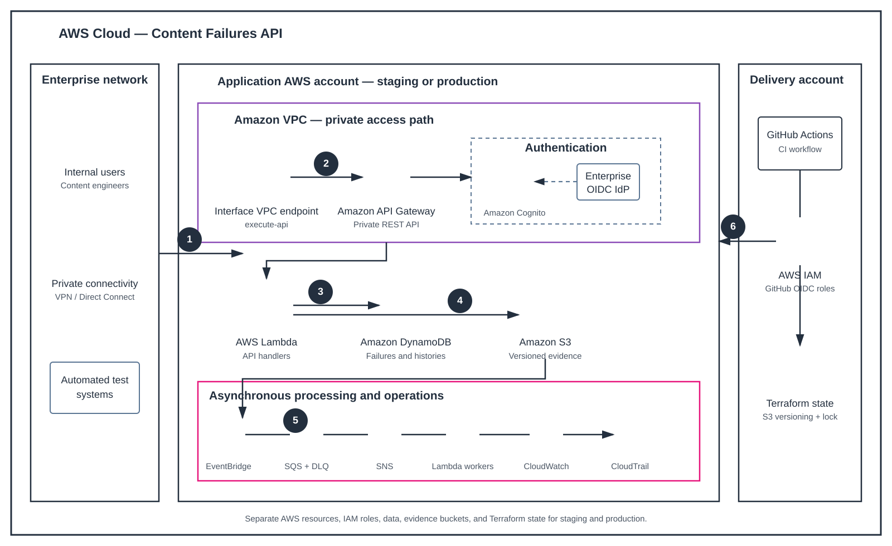

# Content Failures API

The Content Failures API is a proposed enterprise serverless service for recording, validating, investigating, and resolving content failures.

The service is designed for private AWS access and separate staging and production environments. It is currently in the architecture and contract-design phase; application and infrastructure implementation has not started.

## Current design

The proposed platform uses:

- Private Amazon API Gateway REST API
- Enterprise OIDC authentication, with Amazon Cognito federation under review
- AWS Lambda handlers and asynchronous workers
- Amazon DynamoDB for failures, validation history, assignments, findings, remediations, and timeline data
- A separate DynamoDB table for test observations
- Private versioned Amazon S3 storage for evidence attachments
- Pre-signed S3 upload URLs
- Amazon EventBridge and Amazon SQS for asynchronous workflows
- Amazon CloudWatch Logs, metrics, and alarms
- AWS CloudTrail for AWS API auditing
- GitHub Actions with GitHub OIDC and short-lived AWS deployment roles
- Terraform-managed infrastructure

## Architecture



The architecture diagram uses the official AWS Architecture Icons stored in [`docs/aws-icons`](docs/aws-icons).

## API scope

The proposed v1 API supports:

- Content-failure creation, retrieval, listing, updates, and lifecycle transitions
- Ownership by `content_type`, `owning_team`, technical owner, and content validator
- Validation history, including `NOT_REPRODUCED`
- Test observations used to understand failure probability
- Engineering findings
- Remediation and verification
- Comments and immutable timeline events
- Versioned S3 evidence attachments
- Relationships such as duplicates, regressions, and related failures

The contract is documented in [`docs/API_CONTRACT_CONTENT_FAILURES.md`](docs/API_CONTRACT_CONTENT_FAILURES.md).

## Documentation

- [`docs/CONTENT_FAILURES_API_DESIGN.md`](docs/CONTENT_FAILURES_API_DESIGN.md): system design and AWS boundaries
- [`docs/SECURITY_AND_ACCESS_MODEL.md`](docs/SECURITY_AND_ACCESS_MODEL.md): private access, OIDC, IAM, team authorization, and environment isolation
- [`docs/DYNAMODB_ACCESS_PATTERNS.md`](docs/DYNAMODB_ACCESS_PATTERNS.md): DynamoDB keys, indexes, transactions, streams, and Terraform boundaries
- [`docs/API_CONTRACT_CONTENT_FAILURES.md`](docs/API_CONTRACT_CONTENT_FAILURES.md): proposed v1 HTTP contract
- [`docs/content-failures-architecture.svg`](docs/content-failures-architecture.svg): AWS-style architecture diagram
- [`docs/working-standard.md`](docs/working-standard.md): reviewer-first and manual-first project standards

## Environments

Staging and production must use separate:

- API Gateway endpoints
- OIDC/Cognito clients
- IAM roles
- Lambda functions
- DynamoDB tables
- S3 evidence buckets
- EventBridge buses and SQS queues
- CloudWatch log groups and alarms
- Terraform state and locking

Production deployment requires a protected GitHub environment, a reviewed Terraform plan, and explicit approval before apply.

## Development approach

The project follows a specification-first workflow:

```text
Specify → Clarify → Plan → Tasks → Analyze → Implement → Review
```

The first implementation slice is expected to be:

```text
POST /v1/content-failures
GET  /v1/content-failures/{failure_id}
```

It will be implemented in staging first, with private access, OIDC authorization, DynamoDB persistence, CloudWatch logging, and least-privilege IAM.

## Status

Architecture and API design are proposed for review. No production deployment or application implementation is currently claimed by this repository.

